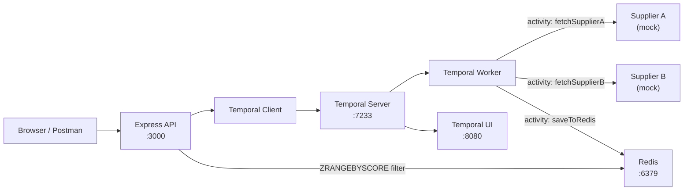

# Hotel Offer Orchestrator

A service that compares hotel prices from two mock suppliers in parallel using **Temporal workflows**, deduplicates by hotel name, keeps only the cheapest offer, caches results in **Redis**, and lets users filter by price range — with filtering performed inside Redis using `ZRANGEBYSCORE`, not in application code.

## Live Deployments

- **Live Frontend**: [https://tripare-ai-assignment-glsd.vercel.app/](https://tripare-ai-assignment-glsd.vercel.app/)
- **Live Backend API**: [https://tripare-ai-assignment.onrender.com](https://tripare-ai-assignment.onrender.com)
  - Health check: [https://tripare-ai-assignment.onrender.com/health](https://tripare-ai-assignment.onrender.com/health)
  - Hotel offers API: [https://tripare-ai-assignment.onrender.com/api/hotels?city=delhi](https://tripare-ai-assignment.onrender.com/api/hotels?city=delhi)

## Architecture



## Tech Stack

| Component | Technology |
|-----------|-----------|
| Runtime | Node.js 20 |
| Language | TypeScript 5 (strict mode) |
| API Framework | Express 4 |
| Workflow Engine | Temporal (TypeScript SDK 1.11) |
| Cache / Index | Redis 7 (alpine) |
| Temporal Persistence | PostgreSQL 15 |
| Logging | pino (structured JSON) |
| Containerization | Docker Compose |
| Testing | Jest + ts-jest |

## Project Structure

```
hotel-offer-orchestrator/
├── src/
│   ├── api/
│   │   ├── server.ts               # Express app, static serving, graceful shutdown
│   │   ├── routes/
│   │   │   ├── hotels.ts           # GET /api/hotels, GET /api/hotels/compare
│   │   │   ├── suppliers.ts        # Mock GET /supplierA/hotels, /supplierB/hotels
│   │   │   ├── health.ts           # GET /health
│   │   │   └── admin.ts            # POST /admin/supplier/:name/toggle
│   │   └── middleware/
│   │       ├── requestLogger.ts    # Request ID + pino child logger
│   │       └── errorHandler.ts     # Centralized JSON error responses
│   ├── temporal/
│   │   ├── workflows.ts            # hotelOfferWorkflow (parallel supplier fetch)
│   │   ├── activities.ts           # fetchSupplierA, fetchSupplierB, saveToRedis
│   │   ├── worker.ts               # Worker entry point with retry-on-startup
│   │   └── client.ts               # Temporal Client singleton + health check
│   ├── redis/
│   │   ├── client.ts               # ioredis singleton + health check
│   │   └── hotelStore.ts           # Save + ZRANGEBYSCORE price-range query
│   ├── domain/
│   │   ├── types.ts                # TypeScript interfaces
│   │   ├── dedupe.ts               # dedupeAndSelectBest (pure, deterministic)
│   │   └── mockData.ts             # Seed data for delhi, mumbai, bengaluru
│   ├── config.ts                   # Environment variable parsing with defaults
│   └── logger.ts                   # pino logger setup
├── public/
│   ├── index.html                  # Frontend SPA
│   ├── styles.css                  # Hand-crafted "travel desk" design
│   └── app.js                      # Vanilla JS app logic
├── tests/
│   └── dedupe.test.ts              # Unit tests for deduplication logic
├── postman/
│   └── hotel-offer-orchestrator.postman_collection.json
├── temporal-config/
│   └── dynamicconfig/
│       └── development-sql.yaml
├── Dockerfile                      # Multi-stage build (builder + production)
├── docker-compose.yml              # Full stack: api, worker, redis, temporal, postgres, temporal-ui
├── .env.example
├── .gitignore
├── .dockerignore
├── .eslintrc.js
├── .prettierrc
├── tsconfig.json
├── jest.config.js
├── package.json
└── README.md
```

## Prerequisites

- **Docker** and **Docker Compose** (required for the full stack)
- **Node.js 20+** and **npm** (only needed for local development without Docker)

## Quick Start

```bash
# Clone the repo
cd hotel-offer-orchestrator

# Copy environment config
cp .env.example .env

# Build and start everything
docker compose up --build
```

Then open:

| URL | What |
|-----|------|
| [http://localhost:3000](http://localhost:3000) | Frontend app |
| [http://localhost:8080](http://localhost:8080) | Temporal UI (inspect workflows) |
| [http://localhost:3000/health](http://localhost:3000/health) | Health check endpoint |

> **Note**: Temporal auto-setup takes 20–40 seconds on first start. The worker retries connecting until Temporal is ready.

## Running Without Docker (Local Dev)

You'll need Redis and Temporal running locally.

```bash
# Install dependencies
npm install

# Start Redis (e.g., via Docker)
docker run -d -p 6379:6379 redis:7-alpine

# Start Temporal dev server
temporal server start-dev --ui-port 8080

# In one terminal: start the API
npm run dev

# In another terminal: start the Temporal worker
npm run dev:worker
```

## Running Tests

```bash
npm install   # if not already done
npm test
```

Tests cover:
- `normalizeHotelName`: trimming, lowercasing, space collapsing
- `dedupeAndSelectBest`: empty lists, no overlap, overlap (cheaper wins), price tie (lower commission wins), full tie (Supplier A wins), case/whitespace differences, sort order, full Delhi seed data verification

## API Reference

### `GET /api/hotels?city=<city>`

Starts a Temporal workflow (or returns cached data) with deduplicated best-price results.

**Query Parameters:**
| Param | Required | Description |
|-------|----------|-------------|
| `city` | Yes | City name (case-insensitive) |
| `minPrice` | No | Minimum price filter (non-negative number) |
| `maxPrice` | No | Maximum price filter (non-negative number) |
| `refresh` | No | Set to `true` to bypass cache and re-run workflow |

**Response** (200):
```json
[
  { "name": "Chandni Residency", "price": 2900, "supplier": "Supplier B", "commissionPct": 14 },
  { "name": "Yamuna View", "price": 3600, "supplier": "Supplier A", "commissionPct": 11 },
  { "name": "Lotus Grand", "price": 4200, "supplier": "Supplier A", "commissionPct": 9 }
]
```

**Response Headers** (when applicable):
- `X-Partial-Result: true` — one supplier failed
- `X-Failed-Suppliers: supplierB` — which supplier(s) failed
- `X-Cached-At: 2024-01-15T10:30:00.000Z` — when data was cached

**Error Responses:**
- `400` — missing city, invalid price, minPrice > maxPrice
- `502` — both suppliers down

### `GET /api/hotels/compare?city=<city>`

Returns both supplier offers per hotel, used by the frontend to show "beat Supplier X by ₹Y" annotations.

### `GET /supplierA/hotels?city=<city>` / `GET /supplierB/hotels?city=<city>`

Mock supplier endpoints returning raw hotel data.

### `POST /admin/supplier/:name/toggle`

Toggle supplier down/up state. `:name` is `a` or `b`.

```json
{ "supplier": "b", "down": true, "message": "Supplier B is now DOWN" }
```

### `GET /health`

```json
{
  "status": "ok",
  "suppliers": { "supplierA": "up", "supplierB": "up" },
  "redis": "up",
  "temporal": "up",
  "checkedAt": "2024-01-15T10:30:00.000Z"
}
```

Returns `200` for `ok`/`degraded`, `503` for `down`.

## Deduplication & Tie-Breaking Logic

1. **Normalize** hotel names: trim whitespace, lowercase, collapse multiple spaces → used as the comparison key
2. **If same hotel in both lists**: pick the **cheaper price**
3. **If prices tie**: pick the **lower `commissionPct`**
4. **If still tied**: **Supplier A wins** (processed first, so it stays in the map)
5. **Hotels unique to one list**: always kept
6. **Final list**: sorted ascending by price

The display name comes from whichever supplier's offer won (original casing preserved).

## Redis Data Model

```
hotel:{city}:{normalizedName}       # Hash: name, price, supplier, commissionPct
hotels:{city}:by_price              # Sorted Set: score=price, member=hash key
hotels:{city}:meta                  # Hash: updatedAt, failedSuppliers, hotelCount
```

All keys have a TTL of `CACHE_TTL_SECONDS` (default 300 = 5 minutes).

**Price filtering uses `ZRANGEBYSCORE` inside Redis:**

```
ZRANGEBYSCORE hotels:delhi:by_price 4000 6000
→ returns matching hash keys
→ pipeline HGETALL for each key
```

The filtering never loads all hotels into Node.js memory — Redis does the work. When no price bounds are given, `ZRANGEBYSCORE` with `-inf` and `+inf` returns all entries (equivalent to `ZRANGE 0 -1` via the same code path).

**Writes** use `MULTI/EXEC` (pipeline) to atomically delete old keys and write new ones.

## Simulating Supplier Outages

Three methods:

1. **Environment variable**: Set `SUPPLIER_A_DOWN=true` or `SUPPLIER_B_DOWN=true` in `docker-compose.yml` or `.env`
2. **Admin API**: `POST /admin/supplier/a/toggle` or `POST /admin/supplier/b/toggle`
3. **Frontend UI**: Click the "sim" checkbox next to each supplier status pill

When one supplier is down:
- The Temporal workflow still completes with partial data
- Response includes `X-Partial-Result: true` and `X-Failed-Suppliers` headers
- Frontend shows a warning banner

When both are down:
- The workflow throws `Both suppliers failed`
- API returns `502`

## Workflow Design

- **Task queue**: `hotel-offers`
- **Workflow ID**: `hotels-{city}-{timestamp}` — unique per request
- **Redis cache**: 5-minute TTL (configurable via `CACHE_TTL_SECONDS`). Repeated requests for the same city return cached data without re-running the workflow.
- **`refresh=true`**: deletes the cache and forces a new workflow execution
- **Activities**: `startToCloseTimeout: 5s`, retry policy with max 3 attempts and exponential backoff starting at 500ms
- **Parallel execution**: `Promise.allSettled` on both supplier activities, so one failure doesn't cancel the other

## Postman Collection

1. Import `postman/hotel-offer-orchestrator.postman_collection.json` into Postman
2. The `baseUrl` variable defaults to `http://localhost:3000`
3. Run with the **Collection Runner** top-to-bottom — the requests are ordered to toggle suppliers and restore them, so running sequentially works correctly

**18 requests** covering: best prices, price ranges, invalid input, unknown city, supplier down (single and both), health check, and raw supplier data.

## Deployment Notes

### VPS / Cloud VM

```bash
# On the server
git clone <repo-url>
cd hotel-offer-orchestrator
cp .env.example .env
docker compose up -d --build
```

### Pushing to a Registry

```bash
docker build -t your-registry.com/hotel-offer-orchestrator:latest .
docker push your-registry.com/hotel-offer-orchestrator:latest
```

Then update `docker-compose.yml` to use `image:` instead of `build:`.

### Production Considerations

- Replace `temporalio/auto-setup` with the production Temporal server deployment
- Use managed Redis (e.g., ElastiCache, Upstash) and managed PostgreSQL
- Add TLS termination (nginx reverse proxy or cloud load balancer)
- Set `NODE_ENV=production` and `LOG_LEVEL=warn`

## Design Decisions & Trade-offs

| Decision | Rationale |
|----------|-----------|
| Temporal for orchestration | Durable execution, built-in retries, visibility into workflow state via UI |
| Redis Sorted Set for price index | O(log N) `ZRANGEBYSCORE` for price filtering without loading all data into Node |
| Mock suppliers in same process | Simplifies Docker setup and testing; in production these would be separate services |
| Unique workflowId per request | Avoids ID conflicts; cache layer prevents redundant workflows |
| `Promise.allSettled` in workflow | One supplier failure doesn't cancel the other — partial results are better than nothing |
| Vanilla JS frontend | No build step needed, keeps the Docker image simple, matches the "hand-crafted" brief |
| `MULTI/EXEC` for Redis writes | Atomic replacement of a city's data, preventing partial reads during update |

## Known Limitations

- **Temporal auto-setup image** is not suitable for production (uses embedded config and auto-migration)
- **Supplier mock data is static** — no real hotel availability or pricing APIs
- **Single Redis instance** — no replication or clustering
- **No authentication** on admin endpoints — the toggle is for demo purposes
- **Frontend annotations** (beat Supplier X by ₹Y) use the static compare endpoint, not the actual workflow result, so they always show even when a supplier was down during the actual fetch

## Environment Variables

| Variable | Default | Description |
|----------|---------|-------------|
| `PORT` | `3000` | API server port |
| `REDIS_URL` | `redis://localhost:6379` | Redis connection URL |
| `TEMPORAL_ADDRESS` | `localhost:7233` | Temporal server address |
| `TEMPORAL_NAMESPACE` | `default` | Temporal namespace |
| `TASK_QUEUE` | `hotel-offers` | Temporal task queue name |
| `SUPPLIER_BASE_URL` | `http://localhost:3000` | Base URL for mock supplier endpoints |
| `SUPPLIER_A_DOWN` | `false` | Simulate Supplier A outage on startup |
| `SUPPLIER_B_DOWN` | `false` | Simulate Supplier B outage on startup |
| `CACHE_TTL_SECONDS` | `300` | Redis cache TTL in seconds |
| `LOG_LEVEL` | `info` | pino log level |
